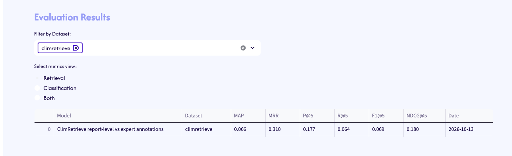

# Benchmarking

**Benchmarking → Results** compares a retrieval run with an expert reference. The table reports ranking metrics. The charts plot the same metrics at each K.

## ClimRetrieve

The stored run compares the ClimRetrieve report-level dataset with the expert-annotated reference. The reference has 681 labelled rows and 26 questions. The report-level input has 47,941 rows and the same 26 questions.

| Metric | Value |
| --- | --- |
| MAP | 0.066 |
| MRR | 0.310 |
| P@1 | 0.192 |
| P@5 | 0.177 |
| P@10 | 0.135 |
| R@1 | 0.010 |
| R@5 | 0.064 |
| R@10 | 0.082 |
| F1@5 | 0.069 |
| NDCG@5 | 0.180 |

MAP is the mean of average precision across questions. MRR is the mean of the reciprocal rank of the first relevant chunk. P@K, R@K, F1@K, and NDCG@K are precision, recall, F1, and normalized discounted cumulative gain in the top K retrieved chunks.

The numbers come from `EvaluationEngine.compare_flexible_datasets` on the transformed ClimRetrieve CSVs. The same method is what the [evaluation engine](../reference/evaluation-engine.md) reference documents.
