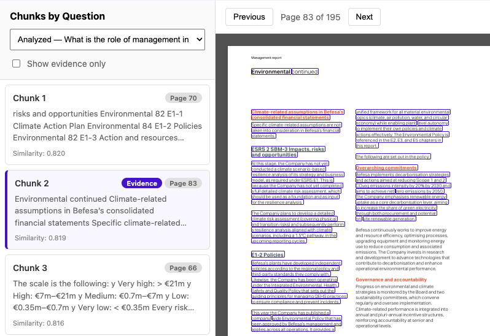

# Chunk highlighting

--8<-- "snippets/enterprise.md"

Stored analysis chunks can be drawn on the PDF page they came from. Evidence chunks are marked in the list and outlined on the page. This uses the enterprise PDF viewer component; the open-core analyst does not include it.

## Open a highlighted page

1. Open **All Results** and select a report that already has an analysis.
2. Open **PDF Viewer with Chunks** and choose a question. Evidence chunks show a page number.
3. Select an evidence chunk. The viewer opens that page and outlines the matching passage.

The example above is the Befesa Annual Report 2025, the TCFD question on management’s role, on page 83. Chunk 2 is marked Evidence. The outlined text is the passage the analysis stored for that chunk.

Highlighting uses the chunk text and the page number stored with the chunk (`page_number`, or `source` when that value is a page). A chunk with no question and no page stays in the list and is not drawn on the page.

See the [PDF viewer](../reference/pdf-viewer.md) API page for the component signature.
